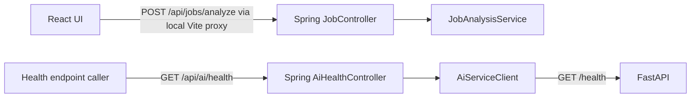

# CareerPilot AI architecture

CareerPilot AI aims to help users tailor résumés and cover letters to job postings using verified professional information. The current implementation accepts a pasted description or posting URL, acknowledges the request, and identifies the selected input source. A separate endpoint checks the Python service.

## Current system

| Module | Technology | Responsibility |
| --- | --- | --- |
| `frontend/` | React, TypeScript, Vite | Collects job input, submits it to Spring, and displays success or error messages. See [package.json](frontend/package.json), [App.tsx](frontend/src/App.tsx), and [jobService.ts](frontend/src/services/jobService.ts). |
| `backend/` | Java 21, Spring Boot, Spring MVC, Jakarta Bean Validation, Spring `RestClient`, Maven | Owns the browser-facing API. Controllers handle HTTP and validation, the job service selects the input source, and a dedicated client calls FastAPI. See [pom.xml](backend/pom.xml) and the [API source](backend/src/main/java/ai/careerpilot/api). |
| `ai-service/` | Python 3.12, FastAPI, Uvicorn | Exposes a health endpoint that returns a fixed status. See [main.py](ai-service/app/main.py), [requirements.txt](ai-service/requirements.txt), and [pyproject.toml](ai-service/pyproject.toml). |

The browser uses relative `/api` URLs. During local development, Vite proxies them to Spring at `http://localhost:8080`. Spring reads the FastAPI address from `ai.service.base-url`, which is set to `http://localhost:8000` in the checked-in configuration. See [vite.config.ts](frontend/vite.config.ts) and [application.yaml](backend/src/main/resources/application.yaml).

## Application endpoints

| Service | Endpoint | Current response |
| --- | --- | --- |
| Spring | `GET /api/jobs/hello` | `200` with plain text `CareerPilot Job API is running!` |
| Spring | `POST /api/jobs/analyze` | `200` with JSON fields `message` and `inputSource`. The source is `description` or `url`. Invalid job input returns `400`. |
| Spring | `GET /api/ai/health` | `200` with the upstream health payload when healthy. An upstream `503` or resource-access failure produces `503` with `{"status":"unavailable"}`. |
| FastAPI | `GET /health` | `200` with `{"status":"ok"}`. This is the only application-defined FastAPI endpoint. |

See [JobController.java](backend/src/main/java/ai/careerpilot/api/controller/JobController.java), [JobAnalysisResponse.java](backend/src/main/java/ai/careerpilot/api/dto/JobAnalysisResponse.java), [AiHealthController.java](backend/src/main/java/ai/careerpilot/api/controller/AiHealthController.java), and [main.py](ai-service/app/main.py).

### Job intake and validation

1. The UI disables submission when both fields are blank or a request is in flight. It trims the inputs and sends an empty `jobUrl` when a nonblank description is present. See [App.tsx](frontend/src/App.tsx).
2. Spring binds `jobUrl` and `jobDescription` from JSON and validates the request before calling the service. At least one field must be nonblank. Any nonblank URL must parse as an absolute HTTP or HTTPS URI with a host. A direct API request with a description and an invalid nonblank URL returns `400`. See [JobAnalysisRequest.java](backend/src/main/java/ai/careerpilot/api/dto/JobAnalysisRequest.java).
3. The service gives a nonblank description precedence and otherwise selects the URL. The UI displays the returned acknowledgement. Job intake ends in Spring without calling Python or storing the input. See [JobAnalysisService.java](backend/src/main/java/ai/careerpilot/api/service/JobAnalysisService.java).

The frontend distinguishes network failures from HTTP errors. It supplies specific messages for HTTP `400`, `502`, and `503`, and includes the status in a generic message for other HTTP failures. See [jobService.ts](frontend/src/services/jobService.ts).

### Python health check

A request to Spring's `/api/ai/health` triggers a call to FastAPI's `/health`. The client maps upstream `503` responses and resource-access exceptions to the unavailable status. Other upstream server errors propagate to Spring's error handling. See [AiServiceClient.java](backend/src/main/java/ai/careerpilot/api/client/AiServiceClient.java).

### Known limitations

- Java-to-Python communication is synchronous. The Spring health request waits for the FastAPI call to return or fail. See [AiServiceClient.java](backend/src/main/java/ai/careerpilot/api/client/AiServiceClient.java).
- `JobDescriptionProcessor` strips surrounding whitespace but is outside the job intake flow. See [JobDescriptionProcessor.java](backend/src/main/java/ai/careerpilot/api/service/JobDescriptionProcessor.java) and [JobAnalysisService.java](backend/src/main/java/ai/careerpilot/api/service/JobAnalysisService.java).
- Job URL retrieval is unimplemented. Intake acknowledges the URL without fetching the posting. See [JobAnalysisService.java](backend/src/main/java/ai/careerpilot/api/service/JobAnalysisService.java).
- Health checks establish endpoint responsiveness. AI model availability is unverified. See [main.py](ai-service/app/main.py).
- Production routing and deployment topology are undefined. The checked-in client and proxy settings point to local services. See [vite.config.ts](frontend/vite.config.ts) and [application.yaml](backend/src/main/resources/application.yaml).

## Testing strategy

- **Backend.** JUnit tests cover input validation, source precedence, and description normalization. Standalone MockMvc tests exercise the job endpoints, including `400` responses. The health controller uses a mocked client, and client tests use `MockRestServiceServer` to simulate health responses and connection failure. A `@SpringBootTest` checks that the application context loads. See the [backend test suite](backend/src/test/java/ai/careerpilot/api).
- **AI service.** Pytest uses FastAPI's `TestClient` to check the health endpoint's status code and JSON body without a listening server. See [test_main.py](ai-service/tests/test_main.py).
- **Frontend and end-to-end coverage.** The frontend has a TypeScript and Vite build and no configured test script. The checked-in tests exercise individual module boundaries. Automated end-to-end coverage of the browser, Spring, and FastAPI together is absent. See [frontend/package.json](frontend/package.json) and the test suites above.

## Planned capabilities and open decisions

[AGENTS.md](AGENTS.md) identifies document generation and model integration as planned. Model calls, professional information verification, and résumé and cover-letter generation are unimplemented. The repository leaves the analysis pipeline, verification workflow, and document output format unspecified.

The [README](README.md) lists LangGraph and Ollama, which are absent from the current runtime. It also mentions PostgreSQL as a proposed technology. Its inclusion does not establish an approved architectural decision. Persistence technology remains undecided.
